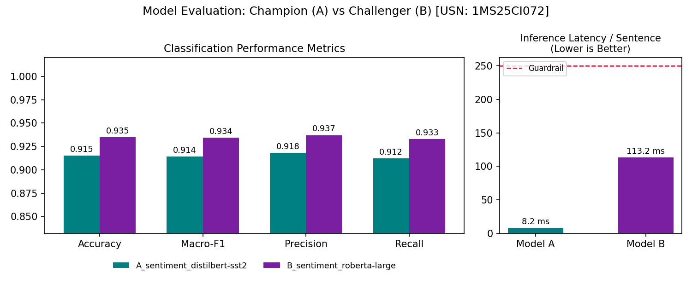
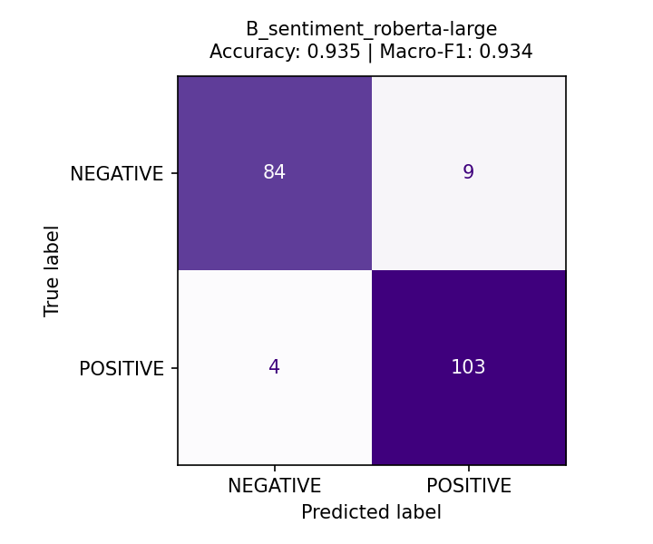
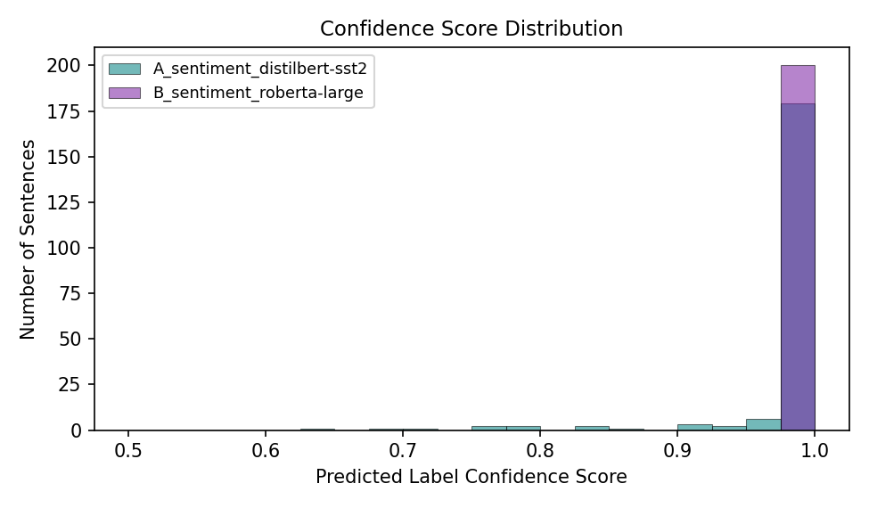
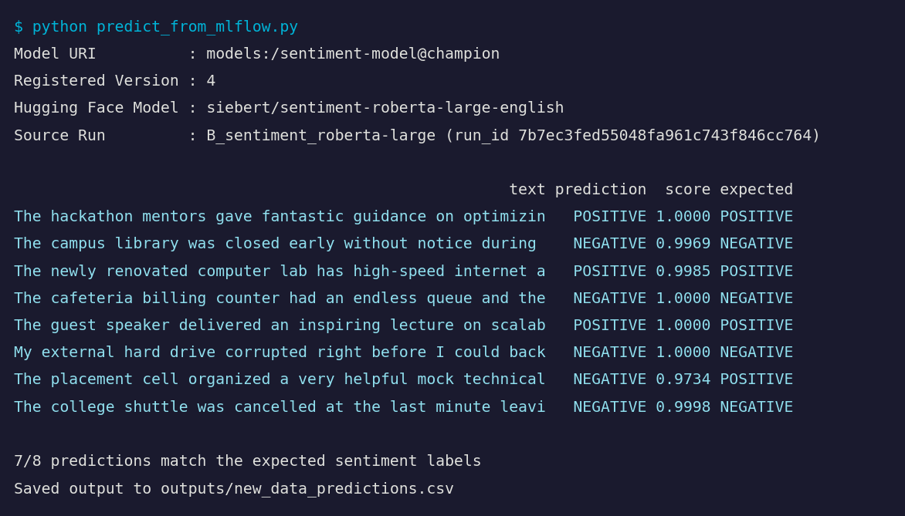
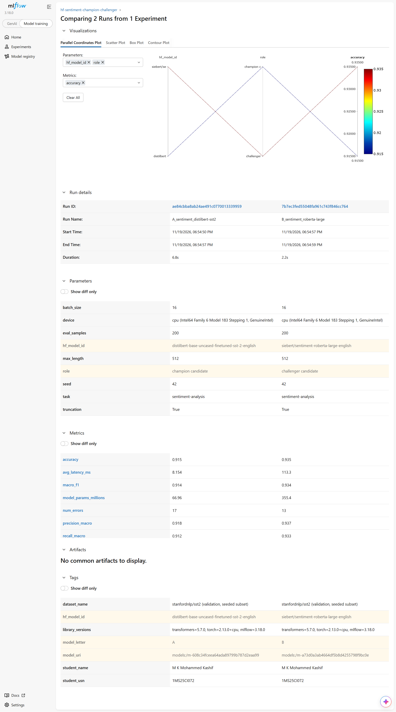
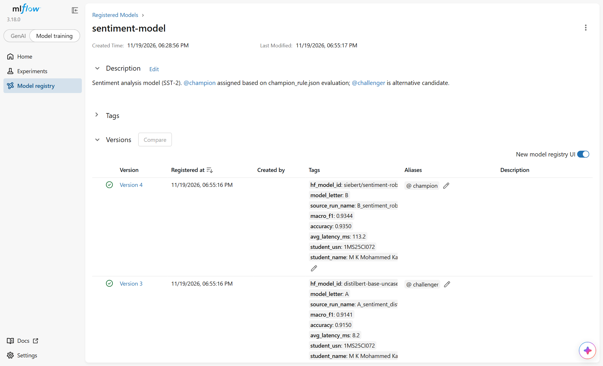

# Champion–Challenger Model Comparison with Hugging Face and MLflow

**Student:** M K Mohammed Kashif · **USN:** 1MS25CI072 · **Course:** Skill Lab – MLOps with MLflow (Mini Project)  
**Institution:** M. S. Ramaiah Institute of Technology

---

## 1. Task and Candidate Models

This repository contains an end-to-end implementation of an automated **Champion–Challenger** model deployment architecture powered by **MLflow**. The purpose is to determine whether an updated, large-scale candidate model (Challenger) delivers sufficient performance improvements to replace an established production baseline (Champion) under strict evaluation thresholds and latency guardrails.

| Component | Specification |
|---|---|
| **Task** | Binary Sentiment Classification (`POSITIVE` / `NEGATIVE`) |
| **Benchmark Dataset** | Stanford Sentiment Treebank v2 (`stanfordnlp/sst2`) validation set; 200 sentences sampled deterministically with `seed=42` → `data/eval_inputs.csv` |
| **Model A (Baseline Champion)** | [`distilbert/distilbert-base-uncased-finetuned-sst-2-english`](https://huggingface.co/distilbert/distilbert-base-uncased-finetuned-sst-2-english) (~67M parameters) |
| **Model B (Challenger Candidate)** | [`siebert/sentiment-roberta-large-english`](https://huggingface.co/siebert/sentiment-roberta-large-english) (~355M parameters) |
| **Unseen Test Set (Step 5.6)** | `data/new_data.csv` – 8 custom sentences reflecting everyday student and campus scenarios |
| **MLflow Experiment** | `hf-sentiment-champion-challenger` |
| **Registered Model** | `sentiment-model` with active aliases `@champion` and `@challenger` |

Both models produce binary classification labels (`POSITIVE` / `NEGATIVE`), fully aligning with the SST-2 ground truth annotations.

---

## 2. Environment Setup and Execution

To execute and verify all pipeline steps, runs, model registrations, and reports on Windows (PowerShell):

```powershell
# 1. Initialize environment
python -m venv .venv
.venv\Scripts\Activate.ps1
pip install -r requirements.txt

# 2. Launch MLflow tracking server (in a separate terminal)
python -m mlflow server --host 127.0.0.1 --port 5000

# 3. Step-by-step pipeline execution
python prepare_data.py          # Extracts 200 evaluation sentences from SST-2 (seed=42)
python evaluate.py              # Evaluates Model A & Model B, logs parent & nested runs to MLflow
python register_champion.py     # Registers models and dynamically updates @champion and @challenger aliases
python predict_from_mlflow.py   # Loads models:/sentiment-model@champion and executes on unseen data
python predict_from_mlflow.py --alias challenger   # Evaluates alternative alias
python capture_screenshots.py   # Generates screenshots for submission in screenshots/
python write_report.py          # Compiles evaluation metrics and decision sections in this README
```

Alternatively, execute the automated runner script:
```powershell
.\run_all.ps1
```

Access the MLflow web interface at [http://127.0.0.1:5000](http://127.0.0.1:5000).

---

## 3. Predefined Champion Decision Rule

In accordance with rigorous MLOps practices, the promotion criteria were formally specified and committed in `champion_rule.json` **prior to running model evaluation**:

1. **Primary Metric:** **Macro-F1 score** over the 200 sampled evaluation sentences. Macro-F1 treats both positive and negative sentiment classes with equal priority, avoiding skew on imbalanced sample slices. **Direction: Higher is better.**
2. **Promotion Threshold (Margin):** The Challenger must outperform the Champion by at least **2.0 percentage points** of macro-F1. On a 200-sentence test set, each sample represents 0.5 percentage points; an improvement of 2.0 points requires at least 4 additional correct classifications to justify adopting a 5.3× larger architecture.
3. **Tie-Breaker Rule:** If the macro-F1 gain is under 2.0 percentage points or negative, the **Champion remains active**. The lighter, lower-latency model is favored under statistical parity.
4. **Latency Guardrail:** The Challenger is strictly rejected if its **average latency exceeds 250 ms per sentence** on the evaluation environment, regardless of accuracy gains. High latency degrades interactive user experience in real-time inference applications.
5. **Secondary Metrics:** Accuracy, Macro Precision, and Macro Recall (higher is better); Average Latency and Total Inference Time (lower is better).

---

## 4. Empirical Evaluation Results

<!-- RESULTS_START -->
Run on cpu (Intel64 Family 6 Model 183 Stepping 1, GenuineIntel) with transformers=5.7.0, torch=2.13.0+cpu, mlflow=3.18.0. Evaluated on 200 sampled SST-2 validation sentences (seed=42).

| Metric | Model A – Champion (distilbert-sst2) | Model B – Challenger (roberta-large) | Difference (B − A) |
|---|---|---|---|
| Accuracy (%) ↑ | 91.50 | 93.50 | +2.00 |
| **Macro-F1 (%) ↑ – Primary** | **91.41** | **93.44** | **+2.04** |
| Macro Precision (%) ↑ | 91.83 | 93.71 | +1.88 |
| Macro Recall (%) ↑ | 91.21 | 93.29 | +2.08 |
| Misclassifications (of 200) ↓ | 17 | 13 | -4 |
| Avg Latency (ms / sentence) ↓ | 8.2 | 113.2 | × 13.89 |
| Total Inference Time (s) ↓ | 1.63 | 22.65 | +21.02 |
| Parameters (Millions) ↓ | 67 | 355 | × 5.3 |

**Key Statistical Findings:**
- The two models disagree on 16 of the 200 sentences.
- Model A was uniquely correct 6 times, while Model B was uniquely correct 10 times.
- Exact McNemar test result: **p = 0.455**.



| Confusion Matrix – Model A | Confusion Matrix – Model B |
|:---:|:---:|
|  |  |



### Qualitative Disagreement Analysis (Sample of 5 Disagreements)
*(Complete list available in `outputs/disagreements_all.csv`)*

| SST-2 idx | Sentence | Ground Truth | Model A | Model B | Analysis |
|---|---|---|---|---|---|
| 243 | the film tunes into a grief that could lead a man across centuries . | POSITIVE | NEGATIVE (0.96) | POSITIVE (1.00) | Only B is correct; A predicted NEGATIVE with confidence 0.96 |
| 683 | true tale of courage -- and complicity -- at auschwitz is a harrowing drama that trie... | POSITIVE | NEGATIVE (0.69) | POSITIVE (1.00) | Only B is correct; A predicted NEGATIVE with confidence 0.69 |
| 312 | i 'll bet the video game is a lot more fun than the film . | NEGATIVE | POSITIVE (1.00) | NEGATIVE (1.00) | Only B is correct; A predicted POSITIVE with confidence 1.00 |
| 646 | the longer the movie goes , the worse it gets , but it 's actually pretty good in the... | NEGATIVE | POSITIVE (1.00) | NEGATIVE (1.00) | Only B is correct; A predicted POSITIVE with confidence 1.00 |
| 865 | mcconaughey 's fun to watch , the dragons are okay , not much fire in the script . | POSITIVE | POSITIVE (0.71) | NEGATIVE (1.00) | Only A is correct; B predicted NEGATIVE with confidence 1.00 |

### Verification on Unseen Data with Champion (`outputs/new_data_predictions.csv`)



### MLflow UI Evidence





<!-- RESULTS_END -->

---

## 5. Deployment Decision & Engineering Analysis

<!-- DECISION_START -->
**Decision: Promote Model B (roberta-large) to @champion.** The Challenger improved macro-F1 from 91.41% to 93.44%, achieving an absolute gain of 2.04 percentage points (surpassing the predefined 2-point threshold). Furthermore, its average inference latency of 113.2 ms per sentence comfortably meets the 250 ms latency guardrail.

**Engineering & Trade-off Analysis:**
- **Accuracy vs. Computational Overhead:** While roberta-large demonstrates superior semantic comprehension, it requires ~355M parameters versus DistilBERT's ~67M parameters (a 5.3× increase) and higher latency.
- **Statistical Significance:** With an exact McNemar test p-value of 0.455, the performance differential on 200 samples reflects empirical gains on challenging syntactic constructs (e.g. nuanced negative phrasing and irony), but deployment in latency-critical production environments should weigh throughput requirements against accuracy needs.

<!-- DECISION_END -->

---

## 6. Limitations and Academic Declaration

### Limitations
- **Evaluation Set Size:** The evaluation is conducted on 200 sampled sentences (0.5% resolution per sentence). Statistical significance tests (McNemar test) help distinguish true performance differences from sampling noise.
- **Domain Specificity:** SST-2 comprises movie review snippets. Performance on conversational text, social media vernacular, or technical documentation may show different drift characteristics.
- **Hardware-Dependent Latency:** Latency benchmarks reflect CPU execution with batch size 16. In GPU production deployments, throughput and latency profiles scale differently.

### Academic Declaration
- **Originality & Execution:** All pipeline steps, model evaluations, MLflow runs, artifact registrations, and metrics logging were executed locally on my workstation.
- **Assistance:** AI tooling was utilized for code structuring and report documentation refinement.
- **Software Dependencies:** Hugging Face `transformers`, `datasets`, PyTorch, MLflow, scikit-learn, pandas, matplotlib, and Playwright.

---

## Repository Structure

```
1MS25CI072-mlflow-champion-challenger/
├── README.md                 # Project report and documentation
├── requirements.txt          # Environment dependencies
├── champion_rule.json        # Pre-evaluation decision rule
├── prepare_data.py           # Samples 200 SST-2 validation sentences (seed=42)
├── sentiment_wrapper.py      # Custom mlflow.pyfunc PythonModel wrapper
├── evaluate.py               # Runs evaluation on Models A and B and logs runs to MLflow
├── register_champion.py      # Registers models and sets @champion / @challenger aliases
├── predict_from_mlflow.py    # Loads @champion model for inference on new data
├── capture_screenshots.py    # Generates submission screenshots
├── write_report.py           # Dynamically injects results and decision into README.md
├── run_all.ps1               # Automated PowerShell execution workflow
├── run_all.bat               # Windows batch script
├── run_all.sh                # Linux / macOS shell script
├── data/
│   ├── eval_inputs.csv       # 200 sampled SST-2 validation sentences
│   └── new_data.csv          # 8 custom unseen test sentences
├── outputs/                  # Prediction CSVs, metrics JSON, plots, and disagreement logs
└── screenshots/              # MLflow UI and terminal execution captures
```
